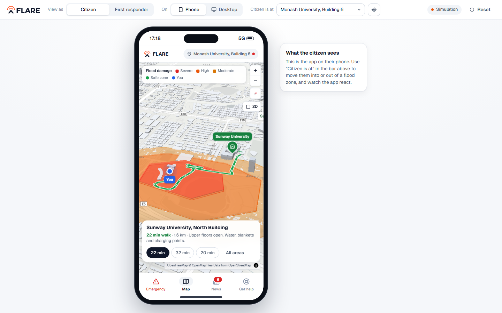
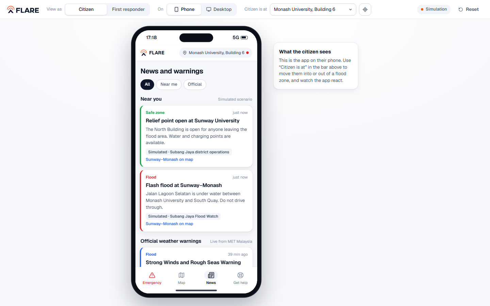
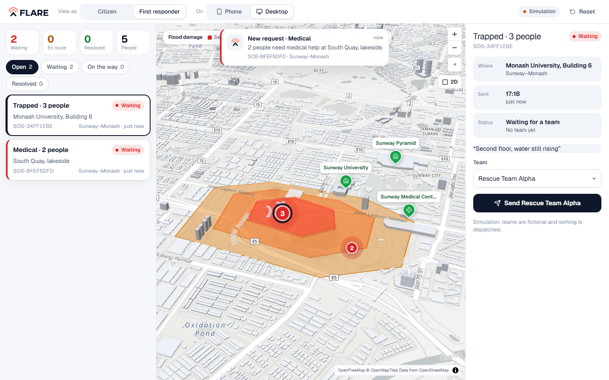
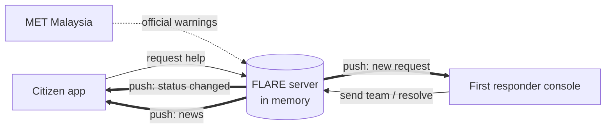

<p align="center">
  
</p>

<h1 align="center">FLARE</h1>

<p align="center"><strong>When the water rises, FLARE tells you what to do next.</strong></p>

<p align="center">A flood alert app that knows where you are. The moment your location is inside a flood zone it alerts you,<br />then shows only what matters: what to do now, who to call, and the way to the nearest safe zone.</p>

> **Hackathon demonstration.** The floods, zones, safe zones, teams and requests are simulated. The weather warnings are real (MET Malaysia). Nothing sent here reaches an emergency service. In a real emergency call 999.

| The alert | The emergency guide | The 3D map and route |
|---|---|---|
|  |  |  |

---

## The problem

Flood apps show a map of everything. A person standing in rising water does not need everything. They need to know three things in the next ten seconds: am I in danger, what do I do, and where do I go. And when they ask for help, they need to see that someone has it.

## What FLARE does

**It starts with one alert.** FLARE checks the phone's location against the marked flood zones. Inside one, it sends an emergency notification. The front door of this demo (`/`) is that moment: a phone on its lock screen.

**Opening the alert opens a guide, not a dashboard.**

- **What to do now**: four plain steps, chosen by how bad the zone is (severe, high or moderate).
- **Who to call**: 999 and the civil defence and disaster lines, one tap each.
- **Where to go**: the nearest safe zones with walking time, and the route drawn on a 3D map.
- **Request rescue**: three taps. No typing needed.

Outside a flood zone the same screen is calm: where the nearest flood is, and what to keep ready.

**The map is 3D.** Real buildings stand up from the street map. Each flood zone is a block of water whose colour and height show its damage level. Safe zones are green pins, and the walking route follows real roads. The scenario includes **Bandar Sunway, around Sunway University and Monash University**, plus Shah Alam, Subang Jaya and Klang.

**News you can read.** Official weather warnings from MET Malaysia arrive live and are labelled *Official*. Scenario updates are labelled *Simulated*. They are never mixed in one list.

**Responders see every request at once.** A request appears in the first responder console, in the queue and on the map, in well under a second. Sending a team or resolving it updates the citizen's phone just as fast.

| News | Request sent, team on the way | First responder console |
|---|---|---|
|  |  |  |

## Try it

Requires **Node 20.19 or newer** and npm.

```bash
npm install
```

```bash
npm start
```

Then open <http://localhost:8787> and tap the alert on the phone.

| Command | What it does |
|---|---|
| `npm start` | Build the client, then serve the app and API on `:8787` |
| `npm run dev` | Live reload: client on `:5173`, API on `:8787` |
| `npm test` | Server tests: API, live events, geometry, scenario integrity, MET feed |
| `npm run build` | Client build and server typecheck |
| `npm run typecheck` | Typecheck both workspaces |
| `node tools/e2e.mjs` | The whole story in a real browser; retakes `docs/screenshots` (see the file header) |

### Finding your way around the demo

The product is the phone app. Everything a tester needs that is *not* part of the product sits in the bar above it:

| Control | What it does |
|---|---|
| **View as** Citizen / First responder | Switch between the two sides of the same incident. |
| **On** Phone / Desktop | Show the current view in a phone frame or on the full screen. |
| **Citizen is at** | Move the simulated citizen. Put them inside a zone and the app raises the alert; move them out and it goes calm. The target button uses the demo place nearest your real location (your position never leaves the browser). |
| **Reset** | Clear every request and restart the scenario. |

A good two-minute run: open `/`, tap the alert, read the guide, open the map, send a request from **Get help**. Open a second tab on **First responder**, send a team, and watch the phone change. The step-by-step script is in [docs/DEMO_RUNBOOK.md](docs/DEMO_RUNBOOK.md).

### Routes

| Path | View |
|---|---|
| `/` | The lock-screen alert |
| `/phone/citizen` | The citizen app in a phone frame (where the alert leads) |
| `/citizen` | The citizen app on a wide screen, beside the map |
| `/phone/responder`, `/responder` | The first responder console |

### Environment variables

| Variable | Effect |
|---|---|
| `PORT` | Port for the server. Default `8787`. |
| `FLARE_LIVE_ALERTS=0` | Turn off the official MET Malaysia warnings. They are on by default, need no key, and need internet. If the feed cannot be reached the news simply has no official items. |

The map needs internet for street tiles and buildings (OpenFreeMap). Offline it falls back to a blank canvas that still shows zones, pins and routes.

## How it works



- **One server, pushed updates.** A single [Hono](https://hono.dev) server holds the scenario and every request in memory. Every open page keeps one server-sent-events stream (`GET /api/events`); when anything changes the server says so and pages refetch at once. Slow polling stays underneath as a safety net.
- **The danger check is geometry.** A location is tested against each zone polygon, worst level first (`client/src/features/citizen/geo.ts`). The guide, the alert and the map all read that one answer.
- **Routes are real roads.** Walking routes from each demo place to each safe zone were computed once on the OpenStreetMap road network and stored with the scenario, so they work offline. They do not know which roads are flooded, and the app says so.
- **One contract.** Client and server share types and scenario data from [`contracts/`](contracts/). The API is documented in [contracts/API_CONTRACT.md](contracts/API_CONTRACT.md).
- **Privacy.** Real GPS is never sent or stored. It only picks the nearest demo place, in the browser.

### Tech stack

| Layer | Tools |
|---|---|
| Client | React 19, TypeScript, Vite 6, MapLibre GL through the mapcn map component, OpenFreeMap vector tiles, Tailwind CSS 4 (map component only), Lucide icons, Geist |
| Server | Node, Hono, server-sent events, tsx |
| Tests | Node's built-in test runner; Playwright for the browser run |

## Project structure

```
client/src/
  App.tsx                   Routes only
  flare/
    theme.css               Design system
    ui.tsx                  Viewer bar, notifications, shared pieces
    data.ts                 Live data hooks, simulated location, "what is my situation"
    FlareMap.tsx            The 3D map
    Landing.tsx             Lock-screen alert
    Citizen.tsx             The citizen app: guide, map, news, get help
    Responder.tsx           The first responder console
    Phone.tsx               Phone frame
  features/citizen/geo.ts   Danger-zone geometry (tested on the server side)
  shared/                   Typed API client with the live stream, logo
  components/ui/map.tsx     mapcn map component
contracts/                  API contract, shared types, scenario data
server/
  src/app.ts, index.ts      HTTP routes, live stream, startup
  src/store/, seed/         In-memory store, scenario loader
  src/live/met.ts           Official MET Malaysia warnings
  tests/                    API, live events, geometry, scenario and feed tests
tools/e2e.mjs               End-to-end browser run and screenshots
docs/
  DEMO_RUNBOOK.md           The demo, step by step
  REAL_DATA.md              What is real, what is simulated, and why
  screenshots/              Taken by tools/e2e.mjs
  process/                  Planning notes from the hackathon day (history only)
```

## Design rules

- Calm and clean: white cards on a soft grey page, one typeface, sentence case.
- Colour carries meaning and nothing else. Red, orange and amber are flood damage levels. Green is safe zones, routes and "resolved". Blue is you, links and official sources.
- In an emergency, show less. The first screen is for getting out; everything else is one tap away.
- Say what is simulated in plain words, wherever a person could mistake it for real.

## Limits

The floods, zones, safe zones and teams are fictional; place names and roads are real. Zones are illustrative, not a measured flood footprint. Routes do not account for flooded roads. There is no sign-in. Requests are held in memory and are lost when the server restarts.

## Team

| | GitHub | Role |
|---|---|---|
| Khaled | [@jeffyoh312](https://github.com/jeffyoh312) | Team lead, responder workflows, QA |
| Sajid | [@69sxjid](https://github.com/69sxjid) | Backend, integration |
| Awais | [@Vais1](https://github.com/Vais1) | Citizen experience, map and geometry, live data |
| Ahmed | [@circleismyfavshape](https://github.com/circleismyfavshape) | Allocation engine (retired with the Recovery feature), logo |

Built with coding agents working in parallel. They coordinate through a pinned GitHub issue using `tools/board`; the rules are in [AGENTS.md](AGENTS.md).
