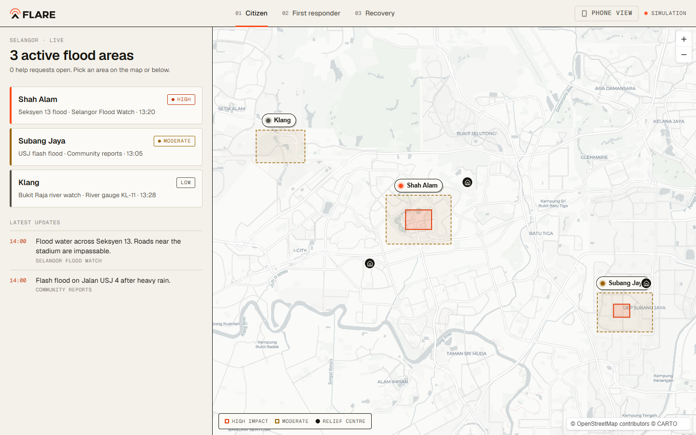
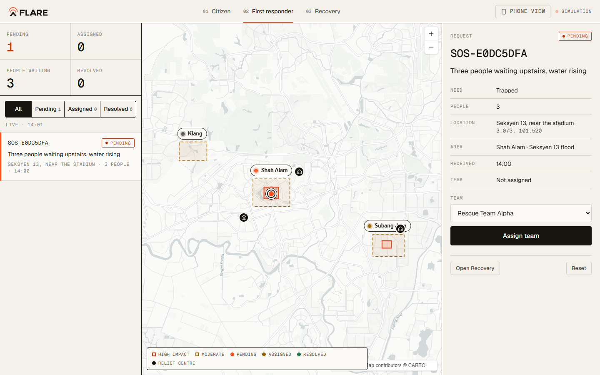
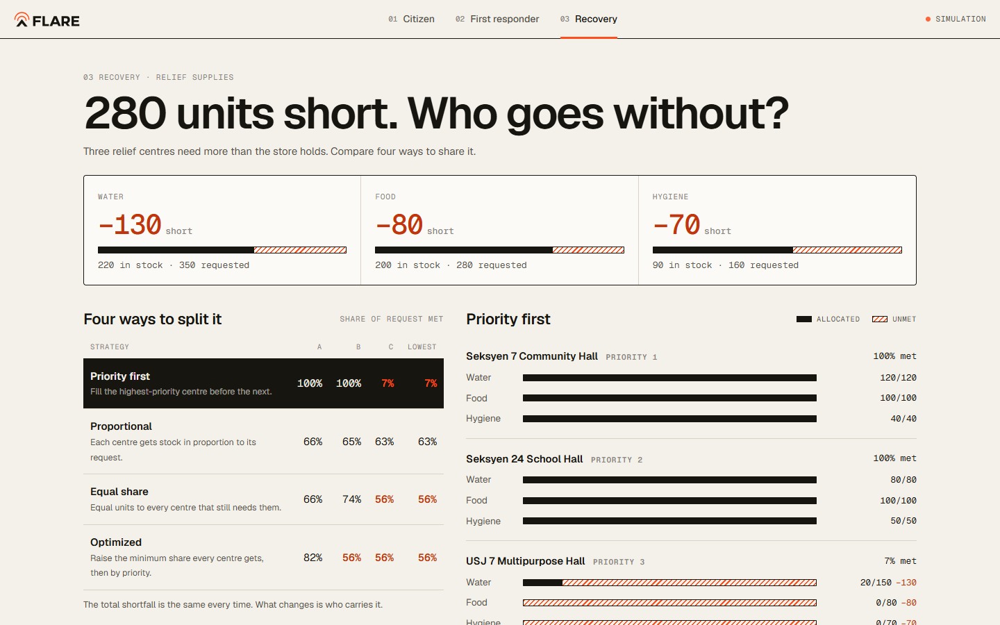
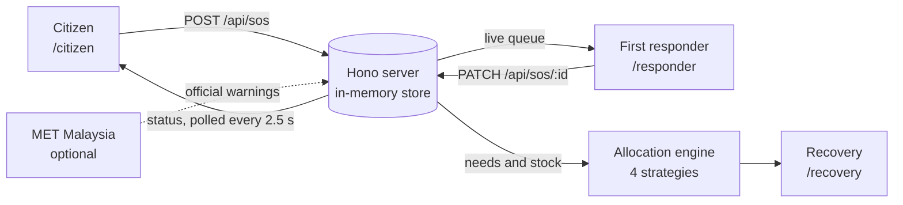

<p align="center">
  
</p>

<h1 align="center">FLARE</h1>

<p align="center"><strong>From the first alert to the last unmet need.</strong></p>

<p align="center">A disaster response and recovery platform that follows one request for help<br />from the person who sends it to the supplies that still have to reach them.</p>

> **Hackathon demonstration.** The flood areas, shelters, teams and requests are simulated. Nothing sent here reaches an emergency service. In a real emergency call 999.

---

## The problem

During a flood, the alert, the call for help and the relief stock usually live in three separate systems. A citizen gets a warning in one place, asks for help in another, and nobody can see whether supplies ever reached them. Each handover is a place where a person gets lost.

## What FLARE does

FLARE keeps all three on one line. A single request keeps the same ID from the moment it is sent until it is resolved, and the same scenario feeds the citizen, the responder and the recovery planner.

| | Interface | Route | What it proves |
|---|---|---|---|
| 01 | **Citizen** | `/citizen` | A live map of every flood area with a feed of sourced updates. Pick an area, check your location, send a request, get a real ID back and watch its status change. |
| 02 | **First responder** | `/responder` | That same request, with the same ID, appears in a live queue and on the map. Assigning a team or resolving it reaches the citizen within seconds. |
| 03 | **Recovery** | `/recovery` | When stock is short, four allocation strategies give different centres the shortfall. Every unit is shown; nothing is hidden in a total. |

The front door (`/`) is a phone on its lock screen with one **EMERGENCY FLOOD** notification. Opening the notification opens the citizen interface, the way it would start for a real person.

| Citizen | First responder | Recovery |
|---|---|---|
|  |  |  |

## Quick start

Requires **Node 20.19 or newer** and npm.

```bash
npm install
```

```bash
npm start
```

`npm start` builds the client and serves everything on <http://localhost:8787>.

| Command | What it does |
|---|---|
| `npm start` | Build the client, then serve the app and API on `:8787` |
| `npm run dev` | Live reload: client on `:5173`, API on `:8787` |
| `npm test` | Server, API and allocation engine tests |
| `npm run build` | Client build and server typecheck |
| `npm run typecheck` | Typecheck both workspaces |

The server reads `index.html` once at startup, so restart it after a rebuild.

### Optional environment variables

| Variable | Effect |
|---|---|
| `PORT` | Port for the server. Default `8787`. |
| `FLARE_LIVE_ALERTS=1` | The updates feed shows official MET Malaysia weather warnings (via `api.data.gov.my`, no key needed) instead of the simulated ones. Needs internet. Off by default. See [docs/REAL_DATA.md](docs/REAL_DATA.md). |
| `ANTHROPIC_API_KEY` | Recovery offers an AI summary of the allocation engine's numbers. Without it the button hides itself. |

The map needs internet for street tiles. Offline it falls back to zones and pins on a blank canvas, and without WebGL the panels still work.

## Demo in 90 seconds

Use two browser tabs on one server. The full script, with fallbacks, is in [docs/DEMO_RUNBOOK.md](docs/DEMO_RUNBOOK.md).

1. **`/`** Read the headline, then tap the **EMERGENCY FLOOD** notification on the phone.
2. **Citizen.** Open **Shah Alam**, pick a location inside the high-impact zone, choose *Trapped*, 3 people, add a line, and send. Read out the request ID.
3. **`/responder`** in the second tab. The same ID is at the top of the queue and pulsing on the map. Assign a team.
4. Back on the citizen tab it already says *Team assigned*. Mark it resolved on the responder tab and the citizen tab follows.
5. **`/recovery`** "280 units short. Who goes without?" Step through the four strategies: *Priority first* leaves one centre with 7%; *Proportional* gives everyone about 65%.

**Reset demo**, at the bottom of the responder detail panel, clears every request before a pitch.

### Phone view

`/phone/citizen` and `/phone/responder` (or the **Phone view** button in the header) show the same live page inside a phone frame at real phone size. It scrolls, and notifications drop in at the top like push alerts.

## How it works



- **One server.** A single [Hono](https://hono.dev) server holds the scenario and every request in memory and serves the built client. There is no database and no sign-in.
- **One contract.** The client and server share types and seed data from [`contracts/`](contracts/). The API is documented in [contracts/API_CONTRACT.md](contracts/API_CONTRACT.md).
- **One map.** Citizen and responder use the same map component, zones, pins and legend.
- **A real allocation engine.** `server/src/recovery/` compares *priority first*, *proportional*, *equal share* and an *optimized* integer program (GLPK.js). It is pure and deterministic: allocated plus unmet always equals what was requested.

### Tech stack

| Layer | Tools |
|---|---|
| Client | React 19, TypeScript, Vite 6, Tailwind CSS 4, MapLibre GL (through mapcn), Lucide icons, Geist |
| Server | Node, Hono, tsx, GLPK.js, Anthropic SDK (optional summary) |
| Tests | Node's built-in test runner |

## Project structure

```
client/
  src/
    App.tsx                 Routes only
    flare/                  The whole front end
      flare.css, extra.css  Design system
      ui.tsx                Shared shell, notifications
      FlareMap.tsx          Shared map
      Landing.tsx           Lock screen front door
      Citizen.tsx  Responder.tsx  Recovery.tsx  Phone.tsx
    shared/                 Typed API client, logo
    features/citizen/geo.ts Map geometry (tested on the server side)
    components/ui/map.tsx   mapcn map component
contracts/                  API contract, shared types, seed data
server/
  src/
    app.ts, index.ts        HTTP routes and startup
    store/, seed/, routes/  In-memory store, fixtures, validation
    recovery/               Allocation engine and AI summary
    live/met.ts             Optional MET Malaysia warnings
  tests/                    API, geometry, engine and live-feed tests
docs/
  DEMO_RUNBOOK.md           The pitch, step by step
  REAL_DATA.md              What is real, what is simulated, and why
  screenshots/              Backup screenshots of every demo step
  process/                  Planning documents from the hackathon
```

## Design rules

- Paper and ink, hairline rules, mono labels for data. Use the classes in `flare.css`; do not add a new colour, font, radius or shadow.
- Orange is the only signal colour and always means "needs attention". Amber means in progress, green means done.
- The same words everywhere: *Pending*, *Team assigned*, *Resolved*.
- Say what is simulated in plain words. Never imply an area is safe or that a route is suggested.

## Limits

Synthetic data only, apart from the optional MET Malaysia warnings. No sign-in. Requests are held in memory and reset when the server restarts. Zones are illustrative, not a measured flood footprint. Shelters and teams are fictional.

## Team

| | GitHub | Role |
|---|---|---|
| Khaled | [@jeffyoh312](https://github.com/jeffyoh312) | Team lead, responder workflows, QA |
| Sajid | [@69sxjid](https://github.com/69sxjid) | Backend, integration, unified front end |
| Awais | [@Vais1](https://github.com/Vais1) | Citizen experience, map and geometry, live data |
| Ahmed | [@circleismyfavshape](https://github.com/circleismyfavshape) | Allocation engine, logo |

