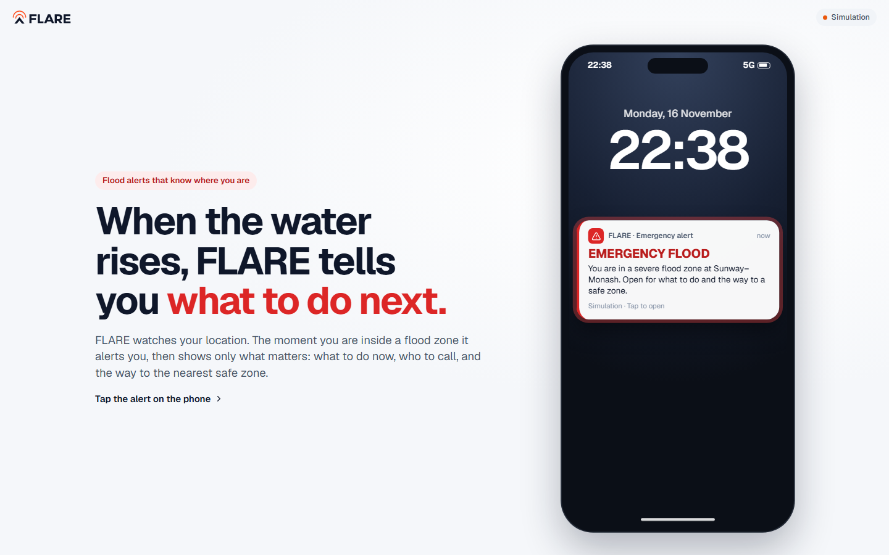
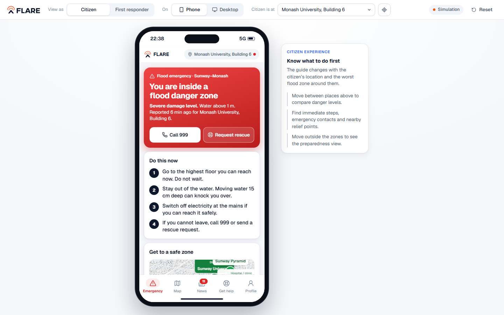
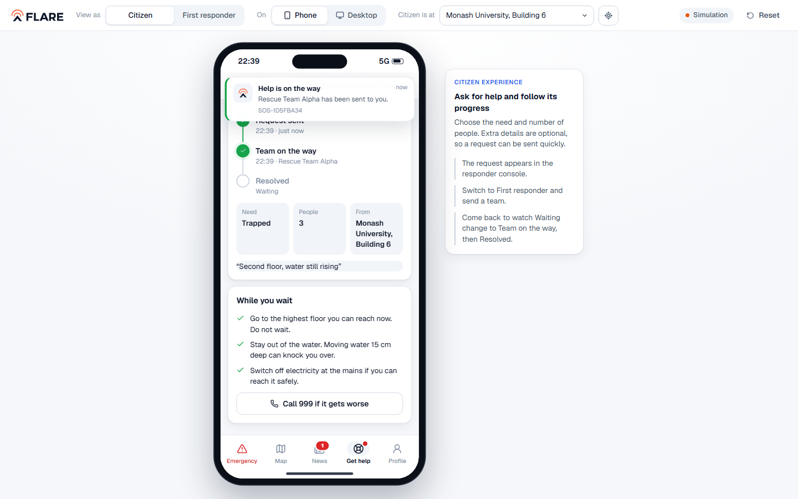
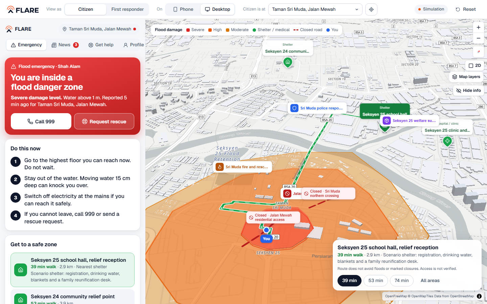
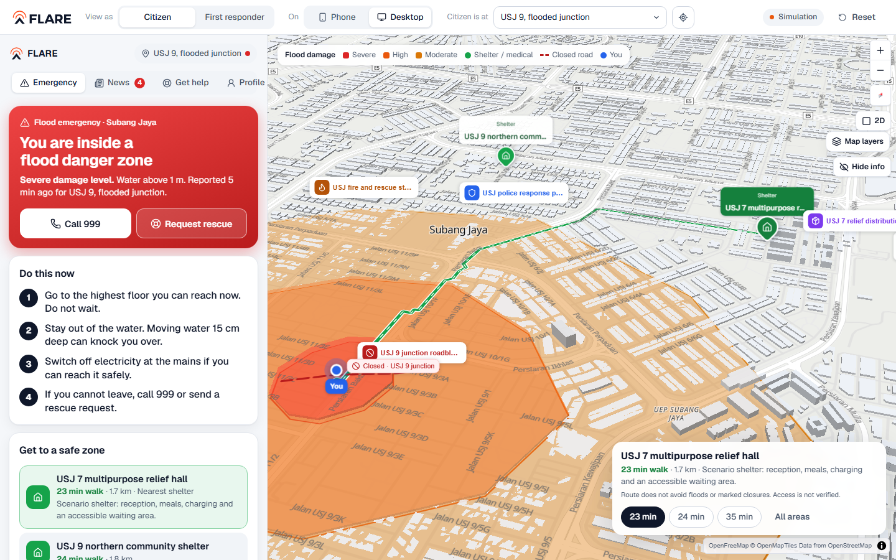
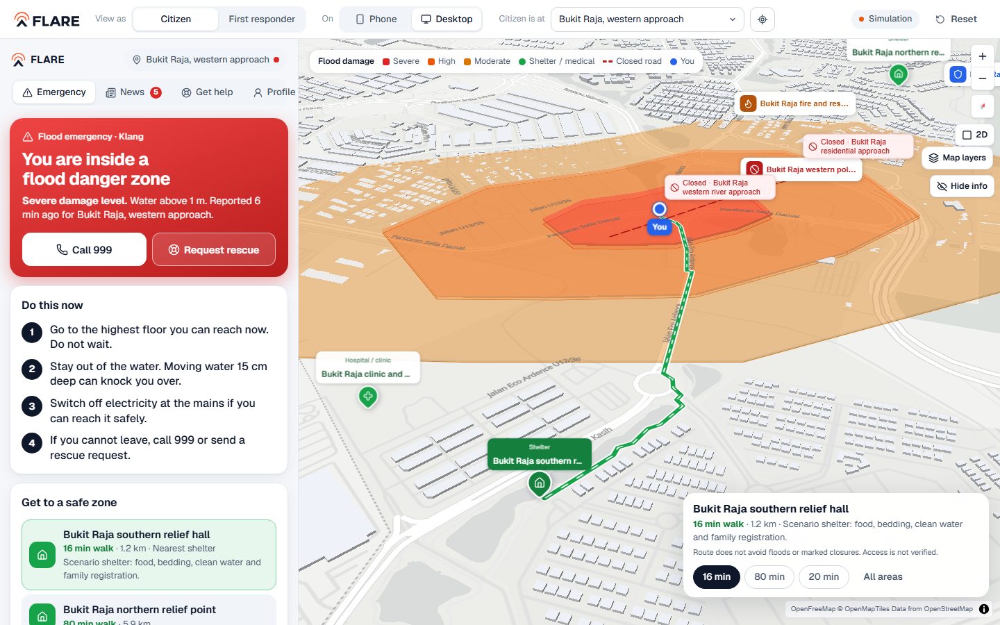
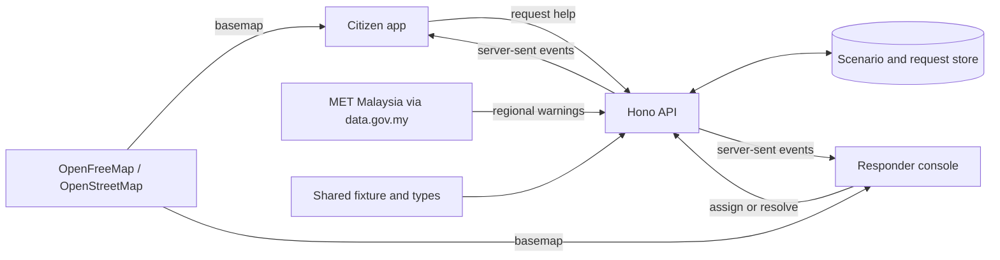

<p align="center">
  
</p>

<h1 align="center">FLARE</h1>

<p align="center"><strong>When the water rises, know what to do next.</strong></p>

<p align="center">Location-based flood guidance and a shared picture of the response.</p>

<p align="center">
  <a href="https://flare-flood-response.vercel.app">Live demo</a> ·
  <a href="#why-this-exists">The problem</a> ·
  <a href="#one-incident-two-perspectives">See the flow</a> ·
  <a href="#run-locally">Run locally</a> ·
  <a href="#how-it-works">How it works</a> ·
  <a href="LICENSE">MIT license</a>
</p>

---

A weather warning tells you heavy rain is coming. Standing on a flooded street, you have more immediate questions: **am I in danger, where can I go, and does anyone know I need help?**

FLARE brings those questions into one flow. A location check opens an emergency guide, a 3D map shows the surrounding situation, and a rescue request stays visible to both the citizen and the responder handling it.

> **Interactive prototype.** Floods, road closures, response posts, relief availability and government-style announcements are simulated. Regional weather warnings come live from MET Malaysia. Requests do not reach emergency services. In a real emergency, call **999**.

| The alert                                                         | The next steps                                                                                            | The local situation                                                                                  |
| ----------------------------------------------------------------- | --------------------------------------------------------------------------------------------------------- | ---------------------------------------------------------------------------------------------------- |
|  |  |  |

## Why this exists

Flooding is a practical, recurring problem in Malaysia. DOSM recorded **RM6.1 billion in losses** from the late-2021 and early-2022 floods, affecting homes, vehicles, businesses and public infrastructure. That figure describes a historical disaster, not the scenario shown in this app. [DOSM report](https://www.dosm.gov.my/index.php/portal-main/release-content/special-report-on-impact-of-floods-in-malaysia-2021).

The World Bank also identifies flood preparedness and resilience as an ongoing need in Malaysia. FLARE explores one part of that wider problem: **how can an interface turn a person's location and the available incident information into clear next steps?** [World Bank research](https://www.worldbank.org/en/country/malaysia/publication/flood-risk-management-leveraging-finance-for-business-resilience-in-malaysia).

The design follows that question. Immediate guidance comes first. The map, news and help request are one tap away. Once a request is sent, its progress remains visible rather than ending with a submission message.

## One incident, two perspectives

### A citizen needs a next step

1. **Open the alert.** The selected location is checked against the illustrated flood polygons. The worst overlapping level determines the guidance.
2. **Read the guide.** See immediate actions, emergency contacts and nearby relief or medical points. Outside the marked zones, the screen switches to preparedness information.
3. **Understand the surroundings.** The 3D map shows streets and buildings, severity contours, walking paths, closed roads, police roadblocks, rescue staging and aid points. Tap a marker for details or change the visible layers. Directions opened from the guide start in a flat 2D view, which is easier to follow; the 2D/3D button switches at any time, and **Hide info** clears the legend, route card and service labels off the map.
4. **Follow the news.** Each section lists the newest update first. The single most recent item is marked **Latest** and named in a strip at the top; items that arrived since the last visit are marked **New**.
5. **Ask for help.** Choose the need and number of people. Additional details are optional. Follow the request from **Waiting** to **Team on the way** and **Resolved**.
6. **Say who you are.** The **Profile** tab holds an avatar, name, age, ID number, medical notes, how to recognise the person and an emergency contact. It is sent with a request unless sharing is switched off on the request form.

Notifications can be cleared by swiping them away on the phone, or with the close button on a wide screen.

### A responder needs the same picture

The console puts requests in a shared queue and on the map. Selecting one brings its location, need, number of people and note together, with the sender's profile when they shared it, so the team knows who to look for. The responder can send a team, change the assignment, return it to the queue or resolve it. Both views receive updates through the same server-sent event stream.

| Updates and weather                                                                                    | The citizen sees progress                                                                | The responder coordinates                                                             |
| ------------------------------------------------------------------------------------------------------ | ---------------------------------------------------------------------------------------- | ------------------------------------------------------------------------------------- |
|  |  |  |

## Four areas, a complete scenario in each

| Area              | Scenario focus                                                                                         |
| ----------------- | ------------------------------------------------------------------------------------------------------ |
| **Sunway–Monash** | Campus and lakeside flooding, Jalan Lagoon Selatan closures, relief reception and rescue staging.      |
| **Shah Alam**     | Taman Sri Muda residential flooding, restricted access, boat deployment and welfare reception.         |
| **Subang Jaya**   | USJ 9 and nearby streets flash flooding, junction closures, drainage inspections and community relief. |
| **Klang**         | Bukit Raja river overflow, controlled crossings, relief supplies and engineering assessments.          |

Each area has **severe, high and moderate contours**, plus an outside-zone location to compare. Across the scenario there are **16 selectable places, 12 relief or medical points, 16 response posts, eight closure segments and 48 stored walking routes**.

The **27 scenario bulletins** include shelter openings, rescue deployments, aid deliveries, road inspections and fictional federal coordination updates. They are released over seven minutes after a reset. Ministry and agency names provide context for the exercise; these are not real announcements or endorsements.

The notes beside the phone explain the feature currently being viewed. Switch between the guide, map, news, help request and responder tools to follow the full flow. See [the scenario guide](docs/SCENARIOS.md) for locations and timing.

<details>
<summary>See Shah Alam, Subang Jaya and Klang</summary>

| Shah Alam                                                                          | Subang Jaya                                                                           | Klang                                                                              |
| ---------------------------------------------------------------------------------- | ------------------------------------------------------------------------------------- | ---------------------------------------------------------------------------------- |
|  |  |  |

</details>

## What is real?

| Information                          | Origin and limits                                                                                                                     |
| ------------------------------------ | ------------------------------------------------------------------------------------------------------------------------------------- |
| Regional weather warnings            | Live MET Malaysia data through data.gov.my; sourced, timestamped and labelled **Official**.                                           |
| Streets and buildings                | OpenStreetMap data served by OpenFreeMap and rendered with MapLibre.                                                                  |
| Walking geometry                     | Prepared on the OpenStreetMap road network using an OSRM walking profile. Stored locally so no route API is needed while using FLARE. |
| Floods, depths and closures          | Illustrated scenario data, not measurements or a flood forecast.                                                                      |
| Relief points and response posts     | Scenario listings. A real place name does not confirm a shelter, an open clinic or a deployed team.                                   |
| Agency bulletins and rescue requests | Simulated. Real weather warnings appear in their own section.                                                                         |

**A walking route is not a verified evacuation route.** It does not avoid the marked floods or closures, account for moving water, or confirm that a destination is reachable. Some paths are long because of the road network. The interface states these limits beside the route.

More detail: [data boundaries](docs/REAL_DATA.md), [research and references](docs/REFERENCES.md), [third-party notices](THIRD_PARTY_NOTICES.md).

## Run locally

When updating an existing installation, stop the running API and development client before installing dependencies, then restart them. This keeps the app and server on the same version and refreshes the development dependency cache.

Requires **Node.js 20.19+** and npm. From the repository root:

```bash
npm ci
npm start
```

Open **http://localhost:8787**. This builds the client and serves it with the API from one process. Keep the terminal open; press `Ctrl+C` to stop.

In Windows PowerShell, use `npm.cmd` if your execution policy blocks `npm.ps1`:

```powershell
npm.cmd ci
npm.cmd start
```

For live reload while editing, run `npm run dev` and open **http://localhost:5173**. Vite proxies API requests to the server on `:8787`.

| Setting               | Effect                                                              |
| --------------------- | ------------------------------------------------------------------- |
| `PORT`                | Server port; defaults to `8787`. The development proxy uses `8787`. |
| `FLARE_LIVE_ALERTS=0` | Disable official weather fetching. Simulated updates continue.      |

Weather and basemap tiles need internet. Without tiles, the map can draw scenario layers on a blank background. Stored routes, guidance and local request handling remain available. Weather failures keep still-valid cached warnings; expired ones are removed.

### Explore it

Open the alert, visit Map and News, then send a request from Get help. Open a second tab as First responder, send a team and watch the citizen's status change. Use **Citizen is at** to compare all four areas and their danger levels. **Reset** clears requests and restarts the update timeline.

| Route              | View                                                |
| ------------------ | --------------------------------------------------- |
| `/`                | Lock-screen alert                                   |
| `/phone/citizen`   | Citizen app in a phone frame, with contextual notes |
| `/citizen`         | Citizen guide beside the map                        |
| `/phone/responder` | Responder console in a phone frame                  |
| `/responder`       | Full responder console                              |

See the [walkthrough](docs/DEMO_RUNBOOK.md) for a repeatable tour.

## How it works



- **One shared contract.** TypeScript types and fixture data in `contracts/` are used by both workspaces. The [API contract](contracts/API_CONTRACT.md) describes endpoints and data fields.
- **Geometry drives the guide.** Point-in-polygon tests give severe zones priority. The result is deterministic and covered by scenario tests.
- **Events refresh the views.** A small event tells each page when requests, the feed or the scenario changed. Pages refetch through a typed client, with polling as a fallback.
- **Late responses are discarded.** Request sequencing prevents older results from overwriting a newer status. Cleanup stops subscriptions and timers when a view closes.
- **Real GPS stays in the browser.** The optional location button chooses the nearest scenario place; raw coordinates are not sent to the server.

| Layer        | Tools                                                                  |
| ------------ | ---------------------------------------------------------------------- |
| Client       | React 19, TypeScript, Vite 6                                           |
| Interface    | CSS design tokens, Lucide icons, Geist; Tailwind for the map component |
| Mapping      | MapLibre GL, mapcn, OpenFreeMap, OpenStreetMap                         |
| Server       | Node.js, Hono, server-sent events, tsx                                 |
| Verification | Node's test runner, Playwright, TypeScript and Prettier                |

## Working on the code

```text
client/src/flare/          Citizen and responder screens, map layers, phone notes and styles
client/src/features/      Pure location and geometry helpers
client/src/shared/        Typed API client and logo
client/src/components/ui/ Adapted map component
contracts/                API types, endpoint documentation and scenario fixture
server/src/               HTTP routes, request store, fixture loading and weather adapter
server/tests/             API, event stream, geometry, scenario and weather checks
tools/                    Browser checks and route maintenance
docs/                     Architecture, scenarios, walkthrough, references and screenshots
```

| Command                              | Purpose                                                                                  |
| ------------------------------------ | ---------------------------------------------------------------------------------------- |
| `npm test`                           | API, request lifecycle, events, geometry, scenario integrity and weather tests           |
| `npm run build`                      | Production client build and both workspace typechecks                                    |
| `npm run typecheck`                  | Typecheck without building                                                               |
| `npm run format`                     | Apply the shared formatting style                                                        |
| `npm run format:check`               | Check formatting                                                                         |
| `npm run e2e`                        | Browser regression walkthrough; see [setup](docs/DEMO_RUNBOOK.md#browser-checks)         |
| `node tools/update-routes.mjs --all` | Rebuild stored walking geometry after editing coordinates; uses the public route service |

The browser walkthrough checks the citizen/responder lifecycle, map layers, all four areas, contextual notes, mobile layouts and connection failures. It also produces the screenshots shown here. See [architecture and maintenance notes](docs/ARCHITECTURE.md) and [contribution guidance](CONTRIBUTING.md).

The [latest review record](docs/VALIDATION.md) reports **84 passing tests** and **21 passing browser steps**, including the live Vercel deployment, with the scope and remaining limits stated alongside the results.

## Current limits

Local development keeps requests in memory until restart or reset. The [hosted demo](https://flare-flood-response.vercel.app) uses shared Redis storage and event delivery on Vercel; see the [deployment guide](docs/DEPLOYMENT.md). Reset clears the hosted queue for all visitors. There is no authentication, background mobile push service, live flood sensing, official dispatch integration or road-passability model. The lock-screen alert demonstrates the entry flow in a browser.

Operational use would require verified flood and closure feeds, validated destinations, authenticated response teams, retention policies and routes assessed against actual conditions. Those capabilities are outside the current implementation.

## Team

Contributions overlapped across the project; these are the main areas each member worked on.

| Member                                                   | Contribution                                                                                                                                   |
| -------------------------------------------------------- | ---------------------------------------------------------------------------------------------------------------------------------------------- |
| [Khaled Morshed](https://github.com/jeffyoh312)          | Team lead and full-stack development across the project, including integration, UI/UX, responder workflows, scenario improvements and testing. |
| [Sajid Anas](https://github.com/69sxjid)                 | Backend lead, application foundation, API contracts, integration and shared UI.                                                                |
| [Mohammed Awais](https://github.com/Vais1)               | Frontend lead, Citizen experience, maps, location and DF checks, live weather data and documentation.                                          |
| [Ahmed Sayedgotb](https://github.com/circleismyfavshape) | Full-stack support, Logo, branding, stratagy and early resource-allocation work.                                                               |

## License

[MIT](LICENSE). Third-party software and data retain their respective licenses and attribution requirements; see [third-party notices](THIRD_PARTY_NOTICES.md).
